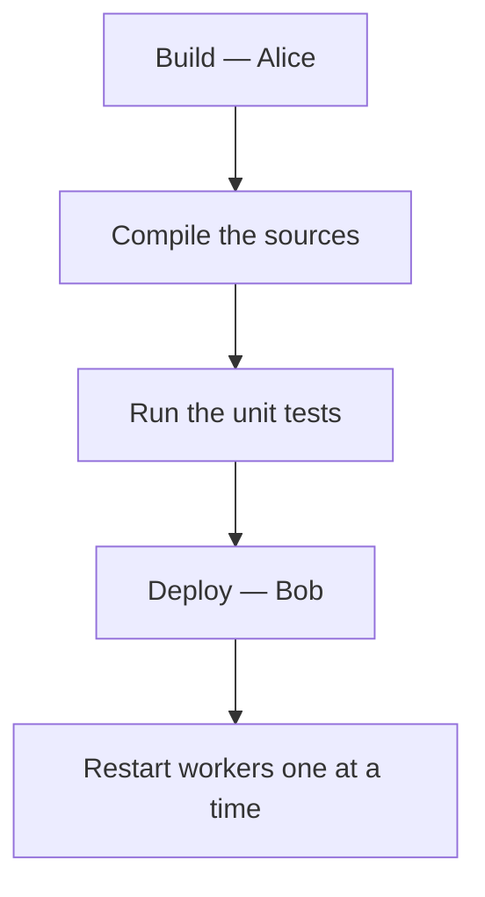
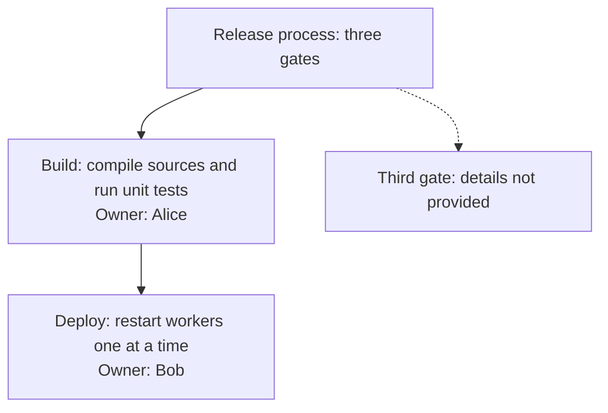
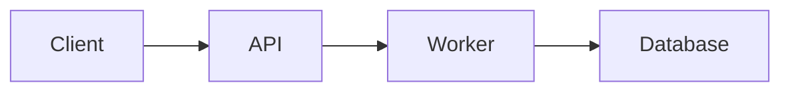

# Human review sheet: real-provider outputs

Generated by `backend/tests/eval/build_review_sheet.py` from the committed evidence in this folder; no provider was called.
The text below is output of the real models (`gpt-6-luna`, with `gemini-embedding-2` retrieval) over a **synthetic** corpus.

How to read an entry. Four things are kept apart, and only the last is yours to fill:

1. The request, the cited passages and the output are copied from the run records.
2. **Automated checks** are mechanical (a quote occurs in its passage, a phrase appears in the cited text, the schema is valid). They do not say whether an answer is true, complete or useful, or whether an edit is safe.
3. **Agent reading** is my own reading, written by hand after reading each output. It is not a human review and it can be wrong.
4. **Human review** is empty.

Run names: `none-answer` is the answer evaluation with classifier effort `none` (2026-11-19, 20:18 UTC); `postfix-answer` and `postfix-proposal` are the earlier post-fix runs; `run1-proposal` and `run2-proposal` are the first two proposal runs, kept here because they are the only real runs in which a proposal needed a repair (the post-fix run needed none). Faults are never injected into real model responses: an item named `...-repaired` in the proposals set is a stub-mode scenario name, and in a real run it only counts as repaired if the model's first reply was rejected.

Sample: 8 answers (each route, and `diagram-release` twice) and 8 proposals (each operation kind, and both real repairs). The full sets are in the `*.records.json` files.

## Answers

### A1 · Question about one fact (qa)

* **Item** `qa-berlin` · **Run** `none-answer` · **Request id** `2bb0c164-eef9-48d0-993c-ed449bc160a4`
* **Request:** "How many parcels did the Berlin depot handle in May?"
* **Sources selected:** depots.pdf
* **Route:** the model chose `qa`, the request ran as `qa` (fallback used: no)

**Passages the answer cited** (an `S` label is a section summary written by the model, not source text)

* `P1` depots.pdf (page 1; passage): Berlin depot report for May. The Berlin depot handled 4200 parcels in May. Staffing at the Berlin depot rose by six people after the spring hiring round. Shift leads at the Berlin depot reviewed loading bays, sorting belts and the returns desk each morning. D…

**Answer as published**

> The Berlin depot handled 4,200 parcels in May.  *(cites [1])*

**Expected evidence (the gold item)**

* Required phrases in the retrieved evidence: "4200 parcels"
* Source(s) the answer should cite: depots.pdf

**Automated checks** (mechanical; from the harness; not a judgement of truth or usefulness)

* Published: yes · citations without an invalid reference or dropped quote: yes · cites the expected source: yes · cited text contains the required phrase: yes
* Retrieval recall@1/3/5: 100%/100%/100% (share of required phrases found in the top k passages; n/a = the item has none) · diagram published/renders: n/a/n/a · latency 4.8 s · failed provider calls for this request: 0

**Agent reading** (my own, written after reading the output; not a human review)

* The sentence matches the cited passage (4200 is written 4,200). One claim, and the harness confirmed the quote. I found nothing unsupported.

**Human review** (leave blank until you assess it)

| Field | Your assessment |
|---|---|
| Factual support: is every statement supported by the source text? (supported / partly / unsupported / not applicable) | |
| Completeness: does it cover what was asked? (complete / partial / missing key points) | |
| Usefulness: would you use it? (1 poor ... 5 very useful) | |
| Notes | |

### A2 · Question about a figure (qa, figure)

* **Item** `figure-handbook` · **Run** `none-answer` · **Request id** `9f8165c7-be60-405b-a110-4ad128475486`
* **Request:** "What does the architecture diagram in the handbook show?"
* **Sources selected:** handbook.docx
* **Route:** the model chose `qa`, the request ran as `qa` (fallback used: no)

**Passages the answer cited** (an `S` label is a section summary written by the model, not source text)

* `P1` handbook.docx (Section 2 overview > Details; passage): Figure 1, diagram: A horizontal diagram shows four light-blue rectangular boxes arranged from left to right and connected in sequence: Client, API, Worker, and Database. Text in the figure: Client API Worker Database Elements: Client; API; Worker; Database Co…

**Answer as published**

> The architecture diagram shows four components arranged in sequence: Client → API → Worker → Database. The figure description is machine-generated, so treat this reading as tentative.  *(cites [1])*

**Expected evidence (the gold item)**

* Required phrases in the retrieved evidence: "Client"
* Source(s) the answer should cite: handbook.docx

**Automated checks** (mechanical; from the harness; not a judgement of truth or usefulness)

* Published: yes · citations without an invalid reference or dropped quote: yes · cites the expected source: yes · cited text contains the required phrase: yes
* Retrieval recall@1/3/5: 100%/100%/100% (share of required phrases found in the top k passages; n/a = the item has none) · diagram published/renders: n/a/n/a · latency 4.5 s · failed provider calls for this request: 0

**Agent reading** (my own, written after reading the output; not a human review)

* Matches the cited figure description (Client, API, Worker, Database, left to right). It says the description is machine-generated. The corpus generator draws exactly those four boxes in that order, so the reading is right for this synthetic figure.

**Human review** (leave blank until you assess it)

| Field | Your assessment |
|---|---|
| Factual support: is every statement supported by the source text? (supported / partly / unsupported / not applicable) | |
| Completeness: does it cover what was asked? (complete / partial / missing key points) | |
| Usefulness: would you use it? (1 poor ... 5 very useful) | |
| Notes | |

### A3 · Summary (summarize)

* **Item** `summarize-release` · **Run** `none-answer` · **Request id** `366a3703-f93f-4db6-a748-9cd5a30c03e0`
* **Request:** "Summarize the release process."
* **Sources selected:** release.md
* **Route:** the model chose `summarize`, the request ran as `summarize` (fallback used: no)

**Passages the answer cited** (an `S` label is a section summary written by the model, not source text)

* `S1` release.md (Release process; section): Every release goes through three gates.
* `S2` release.md (Release process > Build; section): The Build gate compiles the sources and runs the unit tests.
* `S3` release.md (Release process > Deploy; section): Alice owns Build and Bob owns Deploy. During Deploy, workers are restarted one at a time.

**Answer as published**

> Every release passes through three gates. The Build gate compiles the sources and runs unit tests; Alice owns Build, while Bob owns Deploy, where workers are restarted one at a time.  *(cites [1, 2, 3])*

Evidence gaps the answer states: (The material does not identify or describe the third gate.)

**Expected evidence (the gold item)**

* Required phrases in the retrieved evidence: none (summary, comparison and review items have no required phrase)
* Source(s) the answer should cite: release.md

**Automated checks** (mechanical; from the harness; not a judgement of truth or usefulness)

* Published: yes · citations without an invalid reference or dropped quote: yes · cites the expected source: yes · cited text contains the required phrase: n/a
* Retrieval recall@1/3/5: n/a/n/a/n/a (share of required phrases found in the top k passages; n/a = the item has none) · diagram published/renders: n/a/n/a · latency 7.7 s · failed provider calls for this request: 0

**Agent reading** (my own, written after reading the output; not a human review)

* Each statement traces to a cited section, and the note that the third gate is not described is accurate. Short, not exhaustive (it leaves out the table). The cited texts are section summaries the model wrote, not source text: check the statements against the release.md text in Appendix A.

**Human review** (leave blank until you assess it)

| Field | Your assessment |
|---|---|
| Factual support: is every statement supported by the source text? (supported / partly / unsupported / not applicable) | |
| Completeness: does it cover what was asked? (complete / partial / missing key points) | |
| Usefulness: would you use it? (1 poor ... 5 very useful) | |
| Notes | |

### A4 · Comparison of two files (compare)

* **Item** `compare-depots-release` · **Run** `none-answer` · **Request id** `d62b4d29-53b3-431c-9abf-158dafe864d4`
* **Request:** "Compare what the depot report and the release process say about how work is organised."
* **Sources selected:** depots.pdf, release.md
* **Route:** the model chose `compare`, the request ran as `compare` (fallback used: no)

**Passages the answer cited** (an `S` label is a section summary written by the model, not source text)

* `P1` depots.pdf (page 2; passage): in the tracking system, and the Berlin supervisors wrote a short summary of delays at the end of every week. Lisbon depot report for May. The Lisbon depot handled 3100 parcels in May. The Lisbon depot closed early twice because of storms. Shift leads at the L…
* `P2` depots.pdf (page 3; passage): in the tracking system, and the Lisbon supervisors wrote a short summary of delays at the end of every week. Madrid depot report for May. The Madrid depot handled 5100 parcels in May. The Madrid depot added a third sorting belt in April. Shift leads at the Ma…
* `P9` release.md (Release process; passage): Release process Every release goes through three gates.
* `P10` release.md (Release process > Deploy; passage): Stage | Owner Build | Alice Deploy | Bob
* `P11` release.md (Release process > Deploy; passage): The deploy step restarts the workers one at a time.
* `P12` release.md (Release process > Build; passage): Build - compile the sources - run the unit tests
* `P5` depots.pdf (page 1; passage): Berlin depot report for May. The Berlin depot handled 4200 parcels in May. Staffing at the Berlin depot rose by six people after the spring hiring round. Shift leads at the Berlin depot reviewed loading bays, sorting belts and the returns desk each morning. D…
* `P7` depots.pdf (page 6; passage): in the tracking system, and the Oslo supervisors wrote a short summary of delays at the end of every week. Prague depot report for May. The Prague depot handled 3600 parcels in May. The Prague depot moved its returns desk to the east bay. Shift leads at the P…

**Answer as published**

> The depot reports organise work around recurring local operations: shift leads check loading bays, sorting belts and the returns desk each morning; drivers collect routes and scan parcels at the gate; and supervisors write weekly delay summaries. These practices appear in reports for multiple depots.  *(cites [1, 2])*
> The release process organises work as release gates and named steps. It says every release goes through three gates, identifies Alice as Build owner and Bob as Deploy owner, specifies compiling sources and running unit tests for Build, and says Deploy restarts workers one at a time.  *(cites [3, 4, 5, 6])*
> Both describe repeatable procedures, but at different levels: the depot reports emphasize recurring duties, roles and weekly cadence, while the release process emphasizes gated steps, named owners and a specific deployment sequence. The depot reports also mention local changes or disruptions—for example, staffing increases in Berlin and a moved returns desk in Prague—whereas the release-process evidence does not describe depot-style local operating conditions.  *(cites [1, 7, 8, 3, 4, 5])*
> The supplied release-process evidence does not identify the third gate or explain its work; it also does not mention daily depot duties or weekly delay summaries. The depot reports do not describe release gates, named release owners, or build and deploy steps.  *(cites [3, 4, 5, 6, 1])*

Evidence gaps the answer states: (The release process says there are three gates, but the supplied evidence identifies and describes only Build and Deploy; the third gate is unspecified.)

**Expected evidence (the gold item)**

* Required phrases in the retrieved evidence: none (summary, comparison and review items have no required phrase)
* Source(s) the answer should cite: depots.pdf, release.md

**Automated checks** (mechanical; from the harness; not a judgement of truth or usefulness)

* Published: yes · citations without an invalid reference or dropped quote: yes · cites the expected source: yes · cited text contains the required phrase: n/a
* Retrieval recall@1/3/5: n/a/n/a/n/a (share of required phrases found in the top k passages; n/a = the item has none) · diagram published/renders: n/a/n/a · latency 12.2 s · failed provider calls for this request: 0

**Agent reading** (my own, written after reading the output; not a human review)

* Statements trace to the cited passages, but the depot side is thin: it summarises filler text that repeats on every depot page (morning checks, weekly summaries), so the comparison says little. The note that the third gate is unspecified is accurate. A reviewer may rate completeness low.

**Human review** (leave blank until you assess it)

| Field | Your assessment |
|---|---|
| Factual support: is every statement supported by the source text? (supported / partly / unsupported / not applicable) | |
| Completeness: does it cover what was asked? (complete / partial / missing key points) | |
| Usefulness: would you use it? (1 poor ... 5 very useful) | |
| Notes | |

### A5 · Review of the open document (document_review)

* **Item** `review-launch-plan` · **Run** `none-answer` · **Request id** `887ba08c-b58e-4fd2-a0cd-93a75f4f3650`
* **Request:** "Review this document and list its risks."
* **Sources selected:** none (the open document is included)
* **Route:** the model chose `document_review`, the request ran as `document_review` (fallback used: no)

**Passages the answer cited** (an `S` label is a section summary written by the model, not source text)

* `D5` the open document (paragraph; document): Vendor delays could slip the schedule.

**Answer as published**

* Vendor delays could slip the schedule.

Evidence gaps the answer states: (The document does not provide the likelihood or impact of the vendor-delay risk, mitigation plans, or any additional risks.)

**Expected evidence (the gold item)**

* Required phrases in the retrieved evidence: none (summary, comparison and review items have no required phrase)
* Source(s) the answer should cite: none (the open document)

**Automated checks** (mechanical; from the harness; not a judgement of truth or usefulness)

* Published: yes · citations without an invalid reference or dropped quote: yes · cites the expected source: n/a · cited text contains the required phrase: n/a
* Retrieval recall@1/3/5: n/a/n/a/n/a (share of required phrases found in the top k passages; n/a = the item has none) · diagram published/renders: n/a/n/a · latency 5.9 s · failed provider calls for this request: 0

**Agent reading** (my own, written after reading the output; not a human review)

* Lists one risk, the document's own sentence, and says the document gives no likelihood, impact or mitigation. Supported, but it restates the document and does not touch the budget paragraph. Usefulness is for you to judge.

**Human review** (leave blank until you assess it)

| Field | Your assessment |
|---|---|
| Factual support: is every statement supported by the source text? (supported / partly / unsupported / not applicable) | |
| Completeness: does it cover what was asked? (complete / partial / missing key points) | |
| Usefulness: would you use it? (1 poor ... 5 very useful) | |
| Notes | |

### A6 · Diagram request, classifier effort `none` (routed qa)

* **Item** `diagram-release` · **Run** `none-answer` · **Request id** `ec83a5fb-1bc9-4b45-8e09-48a538a0f7ed`
* **Request:** "Draw a flowchart of the build and deploy steps."
* **Sources selected:** release.md
* **Route:** the model chose `qa`, the request ran as `qa` (fallback used: no)

**Passages the answer cited** (an `S` label is a section summary written by the model, not source text)

* `P1` release.md (Release process > Deploy; passage): Stage | Owner Build | Alice Deploy | Bob
* `P2` release.md (Release process > Build; passage): Build - compile the sources - run the unit tests
* `P3` release.md (Release process > Deploy; passage): The deploy step restarts the workers one at a time.

**Answer as published**



Evidence gaps the answer states: (The release process is said to have three gates, but the source does not identify them all; this flowchart shows the documented Build and Deploy steps.)

**Expected evidence (the gold item)**

* Required phrases in the retrieved evidence: "compile the sources"
* Source(s) the answer should cite: release.md

**Automated checks** (mechanical; from the harness; not a judgement of truth or usefulness)

* Published: yes · citations without an invalid reference or dropped quote: yes · cites the expected source: yes · cited text contains the required phrase: yes
* Retrieval recall@1/3/5: 0%/100%/100% (share of required phrases found in the top k passages; n/a = the item has none) · diagram published/renders: yes/yes · latency 12.8 s · failed provider calls for this request: 0

**Agent reading** (my own, written after reading the output; not a human review)

* Steps and owners match the three cited passages. The order Build then Deploy is an inference (the passages do not state an order), and this answer does not flag that; the default-effort answer (A7) does. The note about the third gate is accurate.

**Human review** (leave blank until you assess it)

| Field | Your assessment |
|---|---|
| Factual support: is every statement supported by the source text? (supported / partly / unsupported / not applicable) | |
| Completeness: does it cover what was asked? (complete / partial / missing key points) | |
| Usefulness: would you use it? (1 poor ... 5 very useful) | |
| Notes | |

### A7 · Same request, default effort (routed summarize)

* **Item** `diagram-release` · **Run** `postfix-answer` · **Request id** `ccb9baba-9065-42b6-aff8-890fed21762a`
* **Request:** "Draw a flowchart of the build and deploy steps."
* **Sources selected:** release.md
* **Route:** the model chose `summarize`, the request ran as `summarize` (fallback used: no)

**Passages the answer cited** (an `S` label is a section summary written by the model, not source text)

* `S1` release.md (Release process; section): Every release goes through three gates.
* `S2` release.md (Release process > Build; section): The Build gate compiles the sources and runs the unit tests.
* `S3` release.md (Release process > Deploy; section): Alice owns Build and Bob owns Deploy. The Deploy step restarts the workers one at a time.

**Answer as published**



Evidence gaps the answer states: (The material says there are three gates but describes only Build and Deploy; the third gate is not specified.) (The material does not explicitly state the order of the Build and Deploy gates.)

**Expected evidence (the gold item)**

* Required phrases in the retrieved evidence: "compile the sources"
* Source(s) the answer should cite: release.md

**Automated checks** (mechanical; from the harness; not a judgement of truth or usefulness)

* Published: yes · citations without an invalid reference or dropped quote: yes · cites the expected source: yes · cited text contains the required phrase: no
* Retrieval recall@1/3/5: 0%/0%/0% (share of required phrases found in the top k passages; n/a = the item has none) · diagram published/renders: yes/yes · latency 17.2 s · failed provider calls for this request: 0

**Agent reading** (my own, written after reading the output; not a human review)

* The automated check scores this worse (the required phrase 'compile the sources' is not in the cited text, because the summarize route cites section summaries). On my reading the diagram itself is supported by the same facts, marks the third gate as unspecified, and says the order is not stated. The automated 'worse' may overstate any difference in answer quality. That is for you to judge.

**Human review** (leave blank until you assess it)

| Field | Your assessment |
|---|---|
| Factual support: is every statement supported by the source text? (supported / partly / unsupported / not applicable) | |
| Completeness: does it cover what was asked? (complete / partial / missing key points) | |
| Usefulness: would you use it? (1 poor ... 5 very useful) | |
| Notes | |

### A8 · Diagram of a figure (qa, figure, diagram)

* **Item** `diagram-architecture` · **Run** `none-answer` · **Request id** `10b0e91d-6e40-42f0-86be-cc521ba09fa9`
* **Request:** "Draw the architecture shown in the handbook diagram."
* **Sources selected:** handbook.docx
* **Route:** the model chose `qa`, the request ran as `qa` (fallback used: no)

**Passages the answer cited** (an `S` label is a section summary written by the model, not source text)

* `P1` handbook.docx (Section 2 overview > Details; passage): Figure 1, diagram: A horizontal diagram shows four light-blue rectangular boxes arranged from left to right and connected in sequence: Client, API, Worker, and Database. Text in the figure: Client API Worker Database Elements: Client; API; Worker; Database Co…

**Answer as published**



**Expected evidence (the gold item)**

* Required phrases in the retrieved evidence: "Client"
* Source(s) the answer should cite: handbook.docx

**Automated checks** (mechanical; from the harness; not a judgement of truth or usefulness)

* Published: yes · citations without an invalid reference or dropped quote: yes · cites the expected source: yes · cited text contains the required phrase: yes
* Retrieval recall@1/3/5: 100%/100%/100% (share of required phrases found in the top k passages; n/a = the item has none) · diagram published/renders: yes/yes · latency 6.9 s · failed provider calls for this request: 0

**Agent reading** (my own, written after reading the output; not a human review)

* Client, API, Worker, Database in a line matches the cited figure description.

**Human review** (leave blank until you assess it)

| Field | Your assessment |
|---|---|
| Factual support: is every statement supported by the source text? (supported / partly / unsupported / not applicable) | |
| Completeness: does it cover what was asked? (complete / partial / missing key points) | |
| Usefulness: would you use it? (1 poor ... 5 very useful) | |
| Notes | |

## Proposals (edits and drafts)

### P1 · Edit: rewrite one paragraph

* **Item** `edit-rewrite` · **Run** `postfix-proposal` · **Request id** `52b040a1-8060-4cea-aeef-db83985e6dcb`
* **Request:** "Rewrite this paragraph more clearly."
* **Sources selected:** none · **Target:** block(s) ['B2']

**Proposal as published** (what the preview shows before anyone applies it)

* Summary: Rewrote the paragraph for clarity while preserving its meaning.
* Operation 1: `replace_block_text` · cites passages none · model's reason: "Clarifies the sentence without changing its meaning."
  * before: The launch is scheduled for Friday at noon.
  * after: The launch is scheduled to take place at noon on Friday.

**Expected evidence:** the proposals set has no required phrases. Judge it against the instruction, the source text (Appendix A) and the target blocks (Appendix B). The record stores citation numbers, not the passages they point to.

**Automated checks** (mechanical; from the harness; not a judgement of truth, usefulness or safety)

* Published: yes · valid on the first reply: yes · repaired: no (no problems recorded) · target blocks resolve: yes · citations valid: n/a · invalid citation references: 0 · operations: 1 · latency 4.4 s

**Agent reading** (my own, written after reading the output; not a human review)

* Meaning preserved and one block replaced. 'is scheduled to take place at noon on Friday' is wordier than the original, so whether it is 'clearer' is arguable.

**Human review** (leave blank until you assess it)

| Field | Your assessment |
|---|---|
| Factual support: is every statement supported by the source text? (supported / partly / unsupported / not applicable) | |
| Completeness: does it cover what was asked? (complete / partial / missing key points) | |
| Usefulness: would you use it? (1 poor ... 5 very useful) | |
| Edit safety: would you apply it as is? (safe / needs changes / unsafe) and what would go wrong if applied | |
| Notes | |

### P2 · Edit: insert blocks drawn from a source

* **Item** `edit-insert-from-release` · **Run** `postfix-proposal` · **Request id** `c917659e-d310-4405-ad1a-47e18cac4a79`
* **Request:** "Add a build and deploy section using the release notes."
* **Sources selected:** release.md · **Target:** block(s) ['B3']

**Proposal as published** (what the preview shows before anyone applies it)

* Summary: Added a build and deploy section based on the release notes.
* Operation 1: `insert_blocks_after` · cites passages [1, 2, 3, 4] · model's reason: "Adds the build tasks, responsible owners, and deploy procedure documented in the release notes."
  * before: (nothing)
  * after: [heading] Build and deploy | [bulletList] Build (Alice): compile the sources and run the unit tests. Deploy (Bob): restart the workers one at a time.

**Expected evidence:** the proposals set has no required phrases. Judge it against the instruction, the source text (Appendix A) and the target blocks (Appendix B). The record stores citation numbers, not the passages they point to.

**Automated checks** (mechanical; from the harness; not a judgement of truth, usefulness or safety)

* Published: yes · valid on the first reply: yes · repaired: no (no problems recorded) · target blocks resolve: yes · citations valid: yes · invalid citation references: 0 · operations: 1 · latency 7.8 s

**Agent reading** (my own, written after reading the output; not a human review)

* Inserts a heading and two list items that match release.md (Alice owns Build, compile and run tests, Bob owns Deploy, restart one at a time). Where it lands depends on the anchor: check the placement in the preview.

**Human review** (leave blank until you assess it)

| Field | Your assessment |
|---|---|
| Factual support: is every statement supported by the source text? (supported / partly / unsupported / not applicable) | |
| Completeness: does it cover what was asked? (complete / partial / missing key points) | |
| Usefulness: would you use it? (1 poor ... 5 very useful) | |
| Edit safety: would you apply it as is? (safe / needs changes / unsafe) and what would go wrong if applied | |
| Notes | |

### P3 · Edit: delete a block

* **Item** `edit-delete` · **Run** `postfix-proposal` · **Request id** `4872f83a-197d-4810-8a2a-d3f4504ed9f1`
* **Request:** "Remove the budget paragraph."
* **Sources selected:** none · **Target:** block(s) ['B3']

**Proposal as published** (what the preview shows before anyone applies it)

* Summary: Propose removing the budget paragraph.
* Operation 1: `delete_blocks` · cites passages none · model's reason: "Remove the budget paragraph as requested."
  * before: The budget is forty thousand dollars.
  * after: 

**Expected evidence:** the proposals set has no required phrases. Judge it against the instruction, the source text (Appendix A) and the target blocks (Appendix B). The record stores citation numbers, not the passages they point to.

**Automated checks** (mechanical; from the harness; not a judgement of truth, usefulness or safety)

* Published: yes · valid on the first reply: yes · repaired: no (no problems recorded) · target blocks resolve: yes · citations valid: n/a · invalid citation references: 0 · operations: 1 · latency 4.5 s

**Agent reading** (my own, written after reading the output; not a human review)

* Deletes exactly the budget paragraph that was asked for and nothing else. A deletion is a destructive change until applied, so it needs an explicit approval.

**Human review** (leave blank until you assess it)

| Field | Your assessment |
|---|---|
| Factual support: is every statement supported by the source text? (supported / partly / unsupported / not applicable) | |
| Completeness: does it cover what was asked? (complete / partial / missing key points) | |
| Usefulness: would you use it? (1 poor ... 5 very useful) | |
| Edit safety: would you apply it as is? (safe / needs changes / unsafe) and what would go wrong if applied | |
| Notes | |

### P4 · Edit: insert a diagram

* **Item** `edit-diagram` · **Run** `postfix-proposal` · **Request id** `d1c655fb-7533-43d9-862d-e4afc12a93f2`
* **Request:** "Draw a flowchart of the build and deploy steps."
* **Sources selected:** release.md · **Target:** block(s) ['B3']

**Proposal as published** (what the preview shows before anyone applies it)

* Summary: Added a flowchart of the build and deploy steps.
* Operation 1: `insert_blocks_after` · cites passages [1, 2, 3] · model's reason: "Shows the documented build tasks followed by deployment and its worker restart step."
  * before: (nothing)
  * after: [diagram] flowchart TD A[Compile the sources] --> B[Run the unit tests] B --> C[Deploy] C --> D[Restart workers one at a time]

**Expected evidence:** the proposals set has no required phrases. Judge it against the instruction, the source text (Appendix A) and the target blocks (Appendix B). The record stores citation numbers, not the passages they point to.

**Automated checks** (mechanical; from the harness; not a judgement of truth, usefulness or safety)

* Published: yes · valid on the first reply: yes · repaired: no (no problems recorded) · target blocks resolve: yes · citations valid: yes · invalid citation references: 0 · operations: 1 · latency 14.2 s

**Agent reading** (my own, written after reading the output; not a human review)

* The diagram follows the source steps and owners. Same inference about order as A6. It parses and renders.

**Human review** (leave blank until you assess it)

| Field | Your assessment |
|---|---|
| Factual support: is every statement supported by the source text? (supported / partly / unsupported / not applicable) | |
| Completeness: does it cover what was asked? (complete / partial / missing key points) | |
| Usefulness: would you use it? (1 poor ... 5 very useful) | |
| Edit safety: would you apply it as is? (safe / needs changes / unsafe) and what would go wrong if applied | |
| Notes | |

### P5 · Edit: two operations in one proposal

* **Item** `edit-two-operations` · **Run** `postfix-proposal` · **Request id** `2b990ece-d6b8-4dcb-87dc-7567da715bc1`
* **Request:** "Tighten the launch sentence and add a risk note after the risks paragraph."
* **Sources selected:** none · **Target:** block(s) ['B2', 'B5']

**Proposal as published** (what the preview shows before anyone applies it)

* Summary: Tightened the launch sentence and added a risk note after the risks paragraph, using only the stated vendor-delay risk.
* Operation 1: `replace_block_text` · cites passages none · model's reason: "Make the launch sentence more concise while preserving its timing."
  * before: The launch is scheduled for Friday at noon.
  * after: Launch is Friday at noon.
* Operation 2: `insert_blocks_after` · cites passages none · model's reason: "Add a concise note restating the risk already identified in the paragraph."
  * before: (nothing)
  * after: Risk note: Vendor delays may affect the schedule.

**Expected evidence:** the proposals set has no required phrases. Judge it against the instruction, the source text (Appendix A) and the target blocks (Appendix B). The record stores citation numbers, not the passages they point to.

**Automated checks** (mechanical; from the harness; not a judgement of truth, usefulness or safety)

* Published: yes · valid on the first reply: yes · repaired: no (no problems recorded) · target blocks resolve: yes · citations valid: n/a · invalid citation references: 0 · operations: 2 · latency 7.9 s

**Agent reading** (my own, written after reading the output; not a human review)

* Both operations stay inside the launch plan. 'Launch is Friday at noon.' drops 'scheduled', which turns a plan into a statement of fact; the risk note only restates the existing risk.

**Human review** (leave blank until you assess it)

| Field | Your assessment |
|---|---|
| Factual support: is every statement supported by the source text? (supported / partly / unsupported / not applicable) | |
| Completeness: does it cover what was asked? (complete / partial / missing key points) | |
| Usefulness: would you use it? (1 poor ... 5 very useful) | |
| Edit safety: would you apply it as is? (safe / needs changes / unsafe) and what would go wrong if applied | |
| Notes | |

### P6 · Draft: a new document from a source

* **Item** `draft-proposal` · **Run** `postfix-proposal` · **Request id** `1d75c119-bb9c-4a30-8323-b6cde61a59e8`
* **Request:** "Draft a short project proposal from the release notes."
* **Sources selected:** release.md · **Target:** a new document

**Proposal as published** (what the preview shows before anyone applies it)

* Summary: A short proposal to make the release process described in the notes clearer and more complete, including its three gates, build and deploy steps, and ownership.
* Title: Project Proposal: Clarify and Document the Release Process
* Document: [heading] Project Proposal [heading] Purpose Document and clarify the release workflow so that all three release gates are explicit and the responsibilities and activities at each gate are easy to follow. The notes state that releases pass through three gates, but describe only the build and deploy stages in the available detail. [heading] Proposed Scope [bulletList] Record the build activities: compile the sources and run the unit tests. The notes name Alice as the build owner. Record the deploy activity: restart workers one at a time. The notes name Bob as the deploy owner. Identify and document the third gate, which is mentioned but not described in the notes. [heading] Expected Outcome A concise release-process reference that captures the known gate count, build and deploy steps, and named owners, while making the currently unspecified gate visible for clarification. [heading] Sourc…

**Expected evidence:** the proposals set has no required phrases. Judge it against the instruction, the source text (Appendix A) and the target blocks (Appendix B). The record stores citation numbers, not the passages they point to.

**Automated checks** (mechanical; from the harness; not a judgement of truth, usefulness or safety)

* Published: yes · valid on the first reply: yes · repaired: no (no problems recorded) · target blocks resolve: yes · citations valid: yes · invalid citation references: 0 · operations: 9 · latency 12.3 s

**Agent reading** (my own, written after reading the output; not a human review)

* Stays within the release notes and flags the third gate as unspecified instead of inventing it. 'A proposal to clarify the release process' is a loose reading of 'a short project proposal from the release notes'. Nine operations, all inside the new document.

**Human review** (leave blank until you assess it)

| Field | Your assessment |
|---|---|
| Factual support: is every statement supported by the source text? (supported / partly / unsupported / not applicable) | |
| Completeness: does it cover what was asked? (complete / partial / missing key points) | |
| Usefulness: would you use it? (1 poor ... 5 very useful) | |
| Edit safety: would you apply it as is? (safe / needs changes / unsafe) and what would go wrong if applied | |
| Notes | |

### P7 · REPAIRED in run 1: the first reply was rejected

* **Item** `edit-end-summary` · **Run** `run1-proposal` · **Request id** `not recorded`
* **Request:** "Add a closing summary paragraph."
* **Sources selected:** none · **Target:** the open document (insertion)

**Proposal as published** (what the preview shows before anyone applies it)

* Summary: Added a general closing paragraph; the document content was not provided, so it does not summarize specific points.
* Operation 1: `insert_blocks_after` · cites passages none · model's reason: "Add the requested closing paragraph without introducing unsupported specifics."
  * before: (nothing)
  * after: In summary, the preceding discussion brings together the key points presented above.

**Expected evidence:** the proposals set has no required phrases. Judge it against the instruction, the source text (Appendix A) and the target blocks (Appendix B). The record stores citation numbers, not the passages they point to.

**Automated checks** (mechanical; from the harness; not a judgement of truth, usefulness or safety)

* Published: yes · valid on the first reply: no · repaired: yes (wrong_operation_count) · target blocks resolve: yes · citations valid: n/a · invalid citation references: 0 · operations: 1 · latency 7.5 s

**Agent reading** (my own, written after reading the output; not a human review)

* The first reply had the wrong number of operations; the repaired reply is a generic closing sentence ('the preceding discussion brings together the key points presented above') that says nothing; the model's own summary says the document content was not provided to it. It passed every automated check. I would call it unhelpful, not unsafe.

**Human review** (leave blank until you assess it)

| Field | Your assessment |
|---|---|
| Factual support: is every statement supported by the source text? (supported / partly / unsupported / not applicable) | |
| Completeness: does it cover what was asked? (complete / partial / missing key points) | |
| Usefulness: would you use it? (1 poor ... 5 very useful) | |
| Edit safety: would you apply it as is? (safe / needs changes / unsafe) and what would go wrong if applied | |
| Notes | |

### P8 · REPAIRED in run 2: the first reply was rejected

* **Item** `edit-diagram` · **Run** `run2-proposal` · **Request id** `eb16ef4e-1053-43a4-863e-1efc27f40528`
* **Request:** "Draw a flowchart of the build and deploy steps."
* **Sources selected:** release.md · **Target:** block(s) ['B3']

**Proposal as published** (what the preview shows before anyone applies it)

* Summary: Propose a flowchart of the documented build and deploy steps.
* Operation 1: `insert_blocks_after` · cites passages [1, 2, 3] · model's reason: "Show the documented build sequence followed by deployment and its worker restart step."
  * before: (nothing)
  * after: [diagram] flowchart TD A["Build — Alice"] --> B["Compile the sources"] --> C["Run the unit tests"] --> D["Deploy — Bob"] --> E["Restart workers one at a time"]

**Expected evidence:** the proposals set has no required phrases. Judge it against the instruction, the source text (Appendix A) and the target blocks (Appendix B). The record stores citation numbers, not the passages they point to.

**Automated checks** (mechanical; from the harness; not a judgement of truth, usefulness or safety)

* Published: yes · valid on the first reply: no · repaired: yes (diagram_html_not_allowed) · target blocks resolve: yes · citations valid: yes · invalid citation references: 0 · operations: 1 · latency 16.6 s

**Agent reading** (my own, written after reading the output; not a human review)

* The first reply carried HTML in a diagram (rejected by validation). The repaired diagram is plain Mermaid with owners and matches the source. It is the safe kind of repair: the unsafe content never reached the preview.

**Human review** (leave blank until you assess it)

| Field | Your assessment |
|---|---|
| Factual support: is every statement supported by the source text? (supported / partly / unsupported / not applicable) | |
| Completeness: does it cover what was asked? (complete / partial / missing key points) | |
| Usefulness: would you use it? (1 poor ... 5 very useful) | |
| Edit safety: would you apply it as is? (safe / needs changes / unsafe) and what would go wrong if applied | |
| Notes | |

## Appendix A: the synthetic source texts

`release.md` (the Markdown source used by A3, A6, A7, P2, P4, P6, P7, P8), verbatim:

```markdown
# Release process

Every release goes through three gates.

## Build

- compile the sources
- run the unit tests

## Deploy

| Stage | Owner |
|-------|-------|
| Build | Alice |
| Deploy | Bob |

The deploy step restarts the workers one at a time.
```

`handbook.docx` holds one embedded figure (A2, A8): four light-blue boxes, Client, API, Worker, Database, drawn left to right and joined by lines (generated by `tests/analysis_files.py` `diagram_png`).

`depots.pdf` has eight pages, one depot each, with one exact fact per page (for example the Berlin depot handled 4200 parcels in May) and filler text that repeats on every page. `march-scan.pdf` is three scanned pages read by OCR.

## Appendix B: the open document the edit and review items work on (the launch plan)

* B1. # Launch plan
* B2. The launch is scheduled for Friday at noon.
* B3. The budget is forty thousand dollars.
* B4. ## Risks
* B5. Vendor delays could slip the schedule.
