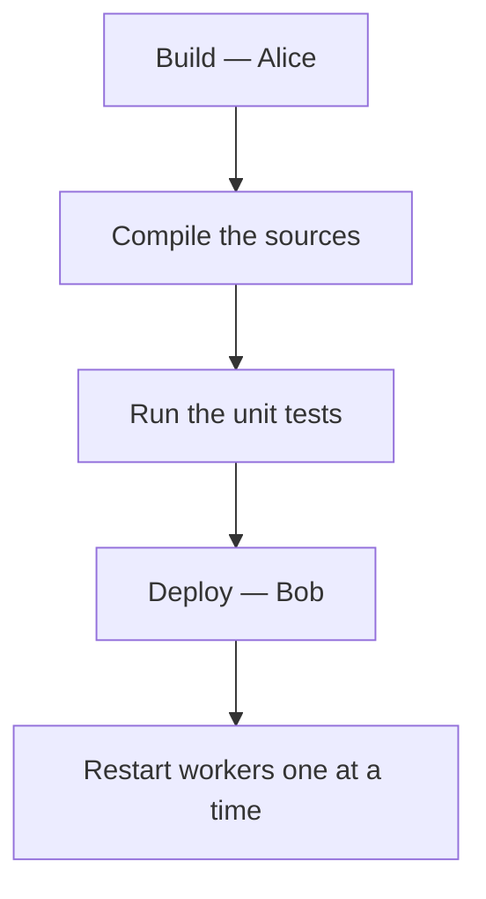

# A6 · Diagram request: build and deploy

* **Item:** `diagram-release`
* **Run:** `new-answer`
* **Code of that run:** `4c41a404d6`
* **Request id:** `de9329ab-ce7c-4c77-b983-574e51254d67`
* **Outcome:** published

## 1. The request

**Instruction, exactly as sent:**

> Draw a flowchart of the build and deploy steps.

* **Operation:** answer in chat
* **Route:** the model chose `qa`, the request ran as `qa` (fallback used: no; hint `auto`)
* **Sources selected (names, immutable versions):**
  * `release.md` version 1 (`7497f2e1-1601-4352-a1a7-34b626011962`), read as **retrieval**: 3 of 3 sections, 4 passages used
* **Open document:** none (no open document was read for this request)

## 2. What the request read (original material)

Ranked original passages (best first), recorded before the answer was generated. Full text.

**P1** · rank 1 · `release.md` · Release process > Deploy · extraction: plain
> Stage | Owner
> Build | Alice
> Deploy | Bob

**P2** · rank 2 · `release.md` · Release process > Build · extraction: plain
> Build
> - compile the sources
> - run the unit tests

**P3** · rank 3 · `release.md` · Release process > Deploy · extraction: plain
> The deploy step restarts the workers one at a time.

**P4** · rank 4 · `release.md` · Release process · extraction: plain
> Release process
> Every release goes through three gates.

Fixture files for this item (synthetic):
* [`release.md`](../fixtures/release.md)

## 3. The output, complete

**Diagram: Build and deploy flow** (render status: ok; cites [1, 2, 3])

**Assumed, not stated in the sources** (shown with the diagram):
- The arrows place the build tasks in the order they are listed; the evidence does not explicitly state their sequence.
- The arrow from Build to Deploy reflects the order in which those stages appear in the table; the evidence does not explicitly state that sequence.

The release process is said to have three gates, but the available details name only Build and Deploy; the third gate is not identified.  *(cites [4], [1])*

**Not found in the sources** (the model's own list of gaps):
- The third release gate is not identified in the evidence.

## 4. Citations and what they open to

#### [1] `P1` · passage · `release.md` · Release process > Deploy
* **What the reader sees as the excerpt:** text of the cited passage
* **Extraction:** plain
* **Provenance recorded:** complete
Excerpt shown to the reader (the first 300 characters the system keeps):
> Stage | Owner
> Build | Alice
> Deploy | Bob
**Original text 1 of 1** · `release.md` version 1 · Release process > Deploy, part 3, extraction: plain · stored-text check: **verified**
> Stage | Owner
> Build | Alice
> Deploy | Bob

#### [2] `P2` · passage · `release.md` · Release process > Build
* **What the reader sees as the excerpt:** text of the cited passage
* **Extraction:** plain
* **Provenance recorded:** complete
Excerpt shown to the reader (the first 300 characters the system keeps):
> Build
> - compile the sources
> - run the unit tests
**Original text 1 of 1** · `release.md` version 1 · Release process > Build, part 2, extraction: plain · stored-text check: **verified**
> Build
> - compile the sources
> - run the unit tests

#### [3] `P3` · passage · `release.md` · Release process > Deploy
* **What the reader sees as the excerpt:** text of the cited passage
* **Extraction:** plain
* **Provenance recorded:** complete
Excerpt shown to the reader (the first 300 characters the system keeps):
> The deploy step restarts the workers one at a time.
**Original text 1 of 1** · `release.md` version 1 · Release process > Deploy, part 4, extraction: plain · stored-text check: **verified**
> The deploy step restarts the workers one at a time.

#### [4] `P4` · passage · `release.md` · Release process
* **What the reader sees as the excerpt:** text of the cited passage
* **Extraction:** plain
* **Provenance recorded:** complete
Excerpt shown to the reader (the first 300 characters the system keeps):
> Release process
> Every release goes through three gates.
**Original text 1 of 1** · `release.md` version 1 · Release process, part 1, extraction: plain · stored-text check: **verified**
> Release process
> Every release goes through three gates.

## 5. Automated results (mechanical; none is a judgement of truth, completeness or usefulness)

| Check | What it is | Result |
|---|---|---|
| Published | the request produced a published answer | True |
| Route | what the model's classification chose, and what the request finally ran as (fallback included) | {"model_route": "qa", "final_route": "qa", "fallback_used": false} |
| required_phrase_coverage (phrase-v1) | share of the item's required phrases found in the top-k evidence passages; a DIAGNOSTIC, NOT retrieval recall (a paraphrase scores 0; a phrase in an irrelevant passage scores 1) | {"@1": 0.0, "@3": 1.0, "@5": 1.0, "@evidence": 1.0} |
| evidence (evidence-v1) | gold evidence units (page / section / figure) covered by the top-ranked ORIGINAL candidates (recall@k) or by the sections/document read (coverage, unranked); see tests/eval/evidence.py | {"version": "evidence-v1", "strategy": "ranked_retrieval", "candidates": 4, "recall": {"@1": {"found": 1, "needed": 2, "value": 0.5}, "@3": {"found": 2, "needed": 2, "value": 1.0}, "@5": {"found": 2, "needed": 2, "value": 1.0}, "@all": {"found": 2, "needed": 2, "value": 1.0}}, "first_hit_rank": 1, "granularity": "section", "gold": [["release.md#section=Release process > Build", "release.md#section=Release process > Deploy"]]} |
| Citations without an invalid reference or dropped quote | the system's own validation: every cited label exists, every quote occurs in its passage; does NOT require citing anything | True |
| Cites the expected source(s) | string check on the cited source names | True |
| Cited text contains the required phrase | string check on the 300-character excerpts (a model-written summary can never contain a source phrase verbatim) | True |
| Derived citations open to verified original text | STRUCTURE only: every derived citation has an origin whose stored text hash still matches; says nothing about support | None |
| Provenance incomplete (count) | citations whose lineage cannot be followed to stored original text | 0 |
| Diagram published / renders | a diagram block exists / its Mermaid parses (SYNTAX only) | True / True |
| Diagram draws directed relations / says they are assumed | what the output SAID about order (its assumptions, gaps); cannot tell whether it is true | True / True |
| Latency (s) / failed provider calls | end to end for this request / calls that did not succeed | 15.5 / 0 |

## Earlier output of the same item (run `none-answer`, the build that was reviewed)

**Diagram: untitled** (render status: ok; cites [1, 2, 3])

**Not found in the sources** (the model's own list of gaps):
- The release process is said to have three gates, but the source does not identify them all; this flowchart shows the documented Build and Deploy steps.

## 6. Agent assessment (my own reading, written by hand after the run; it is NOT a human review and it can be wrong)

* The diagram chains Build, its two tasks, Deploy and the restart step with arrows. The release notes list Build before Deploy but never say one follows the other, and they do not say the two tasks run in that order. The answer says so in two assumptions, which the card shows next to the diagram and the chat message repeats. The third gate is mentioned as unspecified, not named.
* One oddity: the node 'Build - Alice' is followed by arrows to its own tasks, which draws a containment as a sequence. The assumptions disclose the ordering, not that choice. Rendering was checked by the Mermaid parser only; look at it.

## 7. Human review (leave blank until you assess it)

| Field | Your assessment |
|---|---|
| Factual support: is every statement supported by the original text shown above? (supported / partly / unsupported / not applicable) | |
| Completeness: does it cover what was asked? (complete / partial / missing key points) | |
| Usefulness: would you use it? (1 poor ... 5 very useful) | |
| Notes | |
