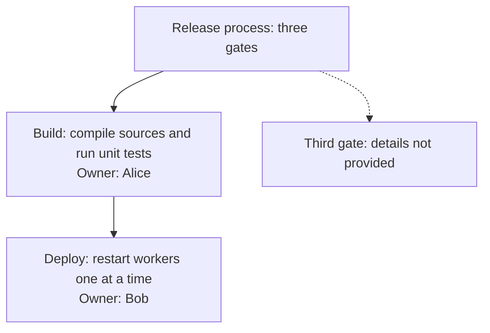

# A7 · Same request in the earlier run at default effort (routed summarize)

* **Item:** `diagram-release`
* **Run:** `postfix-answer` (HISTORICAL: the build that was reviewed; some evidence was not recorded then)
* **Code of that run:** `7a815e7d6d`
* **Request id:** `ccb9baba-9065-42b6-aff8-890fed21762a`
* **Outcome:** published

## 1. The request

**Instruction, exactly as sent:**

> Draw a flowchart of the build and deploy steps.

* **Operation:** answer in chat
* **Route:** the model chose `summarize`, the request ran as `summarize` (fallback used: no; hint `auto`)
* **Sources selected (names, immutable versions):**
  * `release.md` version 1 (`a7795f79-d98e-402c-ab6f-fff80013fa81`), read as **full**: 3 of 3 sections
* **Open document:** none (no open document was read for this request)

## 2. What the request read (original material)

unavailable: this record has no ranked candidates (earlier run). The sources are in `../fixtures/`; the reader can open the cited passages below.

Fixture files for this item (synthetic):
* [`release.md`](../fixtures/release.md)

## 3. The output, complete

**Diagram: untitled** (render status: ok; cites [1, 2, 3])

**Not found in the sources** (the model's own list of gaps):
- The material says there are three gates but describes only Build and Deploy; the third gate is not specified.
- The material does not explicitly state the order of the Build and Deploy gates.

## 4. Citations and what they open to

#### [1] `S1` · section · `release.md` · Release process
* **What the reader sees as the excerpt:** text of the cited passage
* **Extraction:** plain
* **Provenance recorded:** unavailable (this run predates provenance records)
Excerpt shown to the reader (the first 300 characters the system keeps):
> Every release goes through three gates.
**Original evidence:** unavailable: this run did not open the citation's origin.

#### [2] `S2` · section · `release.md` · Release process > Build
* **What the reader sees as the excerpt:** text of the cited passage
* **Extraction:** plain
* **Provenance recorded:** unavailable (this run predates provenance records)
Excerpt shown to the reader (the first 300 characters the system keeps):
> The Build gate compiles the sources and runs the unit tests.
**Original evidence:** unavailable: this run did not open the citation's origin.

#### [3] `S3` · section · `release.md` · Release process > Deploy
* **What the reader sees as the excerpt:** text of the cited passage
* **Extraction:** plain
* **Provenance recorded:** unavailable (this run predates provenance records)
Excerpt shown to the reader (the first 300 characters the system keeps):
> Alice owns Build and Bob owns Deploy. The Deploy step restarts the workers one at a time.
**Original evidence:** unavailable: this run did not open the citation's origin.

## 5. Automated results (mechanical; none is a judgement of truth, completeness or usefulness)

| Check | What it is | Result |
|---|---|---|
| Published | the request produced a published answer | True |
| Route | what the model's classification chose, and what the request finally ran as (fallback included) | {"model_route": "summarize", "final_route": "summarize", "fallback_used": false} |
| required_phrase_coverage (phrase-v1) | share of the item's required phrases found in the top-k evidence passages; a DIAGNOSTIC, NOT retrieval recall (a paraphrase scores 0; a phrase in an irrelevant passage scores 1) | {"@1": 0.0, "@3": 0.0, "@5": 0.0, "@evidence": 0.0} |
| evidence (evidence-v1) | gold evidence units (page / section / figure) covered by the top-ranked ORIGINAL candidates (recall@k) or by the sections/document read (coverage, unranked); see tests/eval/evidence.py | unavailable in this run |
| Citations without an invalid reference or dropped quote | the system's own validation: every cited label exists, every quote occurs in its passage; does NOT require citing anything | True |
| Cites the expected source(s) | string check on the cited source names | True |
| Cited text contains the required phrase | string check on the 300-character excerpts (a model-written summary can never contain a source phrase verbatim) | False |
| Derived citations open to verified original text | STRUCTURE only: every derived citation has an origin whose stored text hash still matches; says nothing about support | None |
| Provenance incomplete (count) | citations whose lineage cannot be followed to stored original text | None |
| Diagram published / renders | a diagram block exists / its Mermaid parses (SYNTAX only) | True / True |
| Diagram draws directed relations / says they are assumed | what the output SAID about order (its assumptions, gaps); cannot tell whether it is true | None / None |
| Latency (s) / failed provider calls | end to end for this request / calls that did not succeed | 17.2 / 0 |

## 6. Agent assessment (my own reading, written by hand after the run; it is NOT a human review and it can be wrong)

* The earlier run at default effort, kept as it was. It routed to summarize and cited section summaries, so the automated 'required phrase in cited text' check scored it 0 although its diagram, third-gate note and order disclosure were sound. The old retrieval 'recall' of 0 for this item came from the same cause: the summarize route retrieves no passages. The new evidence measure reports coverage of the sections read for summarize instead.

## 7. Human review (leave blank until you assess it)

| Field | Your assessment |
|---|---|
| Factual support: is every statement supported by the original text shown above? (supported / partly / unsupported / not applicable) | |
| Completeness: does it cover what was asked? (complete / partial / missing key points) | |
| Usefulness: would you use it? (1 poor ... 5 very useful) | |
| Notes | |
