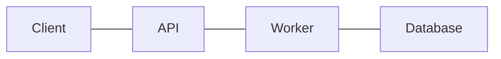
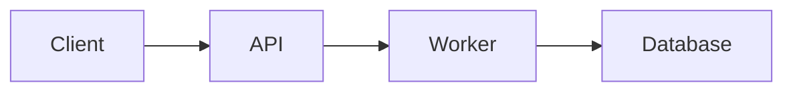

# A8 · Diagram of a figure

* **Item:** `diagram-architecture`
* **Run:** `new-answer`
* **Code of that run:** `4c41a404d6`
* **Request id:** `09818128-4262-4937-867d-b8c1a6a8e3c2`
* **Outcome:** published

## 1. The request

**Instruction, exactly as sent:**

> Draw the architecture shown in the handbook diagram.

* **Operation:** answer in chat
* **Route:** the model chose `qa`, the request ran as `qa` (fallback used: no; hint `auto`)
* **Sources selected (names, immutable versions):**
  * `handbook.docx` version 1 (`3586d4fb-99f7-466b-984a-e1b5d02c9489`), read as **retrieval**: 4 of 5 sections, 6 passages used, 1 of 1 figures examined
* **Open document:** none (no open document was read for this request)

## 2. What the request read (original material)

Ranked original passages (best first), recorded before the answer was generated. Full text.

**P1** · rank 1 · `handbook.docx` · figure 1, Section 2 overview > Details · extraction: vision
> Figure 1, diagram: A simple horizontal diagram shows four light-blue rectangular boxes connected in a row from left to right: Client, API, Worker, and Database.
> Text in the figure: Client API Worker Database
> Elements: Client; API; Worker; Database
> Connections: Client -> API; API -> Worker; Worker -> Database

**P2** · rank 2 · `handbook.docx` · Section 2 overview > Details · extraction: docx
> Stage | Owner
> Build | Alice
> Deploy | Bob

**P3** · rank 3 · `handbook.docx` · Section 1 overview · extraction: docx
> Section 1 overview
> Section 1 describes the deployment pipeline. alpha alpha alpha alpha alpha alpha alpha alpha alpha alpha alpha alpha alpha alpha alpha alpha alpha alpha alpha alpha alpha alpha alpha alpha alpha alpha alpha alpha alpha alpha alpha alpha alpha alpha alpha alpha alpha alpha alpha alpha alpha alpha alpha alpha alpha alpha alpha alpha alpha alpha alpha alpha alpha alpha alpha alpha alpha alpha alpha alpha

**P4** · rank 4 · `handbook.docx` · Section 1 overview > Details · extraction: docx
> Details
> - Build the release candidate

**P5** · rank 5 · `handbook.docx` · Section 2 overview > Details · extraction: docx
> Details
> - Build the release candidate

**P6** · rank 6 · `handbook.docx` · Section 2 overview · extraction: docx
> Section 2 overview
> Section 2 describes the deployment pipeline. alpha alpha alpha alpha alpha alpha alpha alpha alpha alpha alpha alpha alpha alpha alpha alpha alpha alpha alpha alpha alpha alpha alpha alpha alpha alpha alpha alpha alpha alpha alpha alpha alpha alpha alpha alpha alpha alpha alpha alpha alpha alpha alpha alpha alpha alpha alpha alpha alpha alpha alpha alpha alpha alpha alpha alpha alpha alpha alpha alpha

Fixture files for this item (synthetic):
* [`handbook.docx`](../fixtures/handbook.docx)
* [`architecture-figure.png`](../fixtures/architecture-figure.png)

## 3. The output, complete

**Diagram: Architecture** (render status: ok; cites [1])

## 4. Citations and what they open to

#### [1] `P1` · passage · `handbook.docx` · figure 1, Section 2 overview > Details
* **What the reader sees as the excerpt:** text of the cited passage
* **Extraction:** vision
* **Machine-generated:** yes (OCR, vision or figure description)
* **Provenance recorded:** complete
Excerpt shown to the reader (the first 300 characters the system keeps):
> Figure 1, diagram: A simple horizontal diagram shows four light-blue rectangular boxes connected in a row from left to right: Client, API, Worker, and Database.
> Text in the figure: Client API Worker Database
> Elements: Client; API; Worker; Database
> Connections: Client -> API; API -> Worker; Worker ->
**Original text 1 of 1** · `handbook.docx` version 1 · Section 2 overview > Details, part 6, extraction: vision · stored-text check: **verified**
> Figure 1, diagram: A simple horizontal diagram shows four light-blue rectangular boxes connected in a row from left to right: Client, API, Worker, and Database.
> Text in the figure: Client API Worker Database
> Elements: Client; API; Worker; Database
> Connections: Client -> API; API -> Worker; Worker -> Database
Original figure image: see `../fixtures/architecture-figure.png` (the figure this citation points to, generated by `tests/analysis_files.py`).

## 5. Automated results (mechanical; none is a judgement of truth, completeness or usefulness)

| Check | What it is | Result |
|---|---|---|
| Published | the request produced a published answer | True |
| Route | what the model's classification chose, and what the request finally ran as (fallback included) | {"model_route": "qa", "final_route": "qa", "fallback_used": false} |
| required_phrase_coverage (phrase-v1) | share of the item's required phrases found in the top-k evidence passages; a DIAGNOSTIC, NOT retrieval recall (a paraphrase scores 0; a phrase in an irrelevant passage scores 1) | {"@1": 1.0, "@3": 1.0, "@5": 1.0, "@evidence": 1.0} |
| evidence (evidence-v1) | gold evidence units (page / section / figure) covered by the top-ranked ORIGINAL candidates (recall@k) or by the sections/document read (coverage, unranked); see tests/eval/evidence.py | {"version": "evidence-v1", "strategy": "ranked_retrieval", "candidates": 6, "recall": {"@1": {"found": 1, "needed": 1, "value": 1.0}, "@3": {"found": 1, "needed": 1, "value": 1.0}, "@5": {"found": 1, "needed": 1, "value": 1.0}, "@all": {"found": 1, "needed": 1, "value": 1.0}}, "first_hit_rank": 1, "granularity": "figure", "gold": [["handbook.docx#figure=1"]]} |
| Citations without an invalid reference or dropped quote | the system's own validation: every cited label exists, every quote occurs in its passage; does NOT require citing anything | True |
| Cites the expected source(s) | string check on the cited source names | True |
| Cited text contains the required phrase | string check on the 300-character excerpts (a model-written summary can never contain a source phrase verbatim) | True |
| Derived citations open to verified original text | STRUCTURE only: every derived citation has an origin whose stored text hash still matches; says nothing about support | None |
| Provenance incomplete (count) | citations whose lineage cannot be followed to stored original text | 0 |
| Diagram published / renders | a diagram block exists / its Mermaid parses (SYNTAX only) | True / True |
| Diagram draws directed relations / says they are assumed | what the output SAID about order (its assumptions, gaps); cannot tell whether it is true | False / False |
| Latency (s) / failed provider calls | end to end for this request / calls that did not succeed | 10.2 / 0 |

## Earlier output of the same item (run `none-answer`, the build that was reviewed)

**Diagram: untitled** (render status: ok; cites [1])

## 6. Agent assessment (my own reading, written by hand after the run; it is NOT a human review and it can be wrong)

* Undirected: Client --- API --- Worker --- Database. It matches the figure, which has lines and no arrowheads (see fixtures/architecture-figure.png). The earlier build drew arrows here; this answer does not claim a direction the image does not show.

## 7. Human review (leave blank until you assess it)

| Field | Your assessment |
|---|---|
| Factual support: is every statement supported by the original text shown above? (supported / partly / unsupported / not applicable) | |
| Completeness: does it cover what was asked? (complete / partial / missing key points) | |
| Usefulness: would you use it? (1 poor ... 5 very useful) | |
| Notes | |
