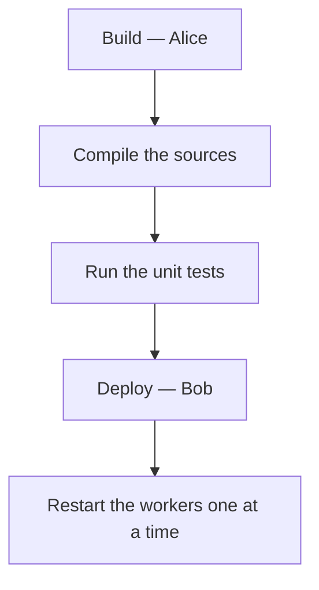
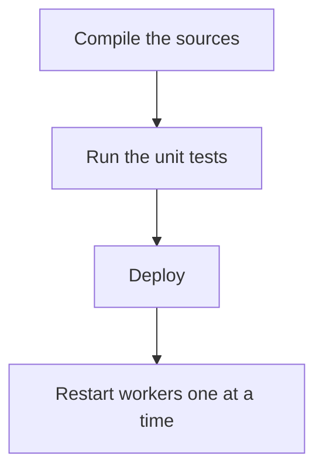

# P4 · Edit: insert a diagram

* **Item:** `edit-diagram`
* **Run:** `new-proposal`
* **Code of that run:** `4c41a404d6`
* **Request id:** `5d8a4270-dc7e-48b1-ae51-0222a5f089a6`
* **Outcome:** published

## 1. The request

**Instruction, exactly as sent:**

> Draw a flowchart of the build and deploy steps.

* **Operation:** edit
* **Target of the edit:** {"blocks": [2], "range": null, "insert_at": null}
* **Sources selected (names, immutable versions):**
  * `release.md` version 1 (`63ec67af-950a-44ee-b609-6d8988ad786f`)
* **Open document:** document `d5193a2c-40ee-4b1a-8485-033be48b1f98`, captured at update counter 7, scope `edit`, mode `target_plus_context`, content hash `d25b6ce6d4889a4b…`; context shown to the model: **full** (complete), 5 of 5 blocks, 0 not shown, 0 cut short

## 2. What the request read (original material)

See the citations below: each lists the original text it opens to.

Fixture files for this item (synthetic):
* [`launch-plan.md`](../fixtures/launch-plan.md)
* [`release.md`](../fixtures/release.md)

## 3. The output, complete

**Summary the model gave:** Proposed a flowchart of the documented build and deploy steps.

**Target as captured (complete, before any change):**

The budget is forty thousand dollars.

### Change 1: `insert_blocks_after`

*The model's reason:* Show the named build and deploy steps and their listed owners. The connections are marked as inferred because the evidence does not explicitly state their order.
*Cites:* [1], [2], [3]

**Assumed, not stated in the sources** (shown in the preview):
* Arrows show an inferred sequence: the build actions follow their listed order, and Build precedes Deploy in the stage listing; the evidence does not explicitly state these sequences.

**Before:**

(nothing)

**After:**

*Assumed, not stated in the source: Arrows show an inferred sequence: the build actions follow their listed order, and Build precedes Deploy in the stage listing; the evidence does not explicitly state these sequences.*

## 4. Citations and what they open to

#### [1] `P1` · passage · `release.md` · Release process > Deploy
* **What the reader sees as the excerpt:** text of the cited passage
* **Extraction:** plain
* **Provenance recorded:** complete
Excerpt shown to the reader (the first 300 characters the system keeps):
> Stage | Owner
> Build | Alice
> Deploy | Bob
**Original text 1 of 1** · `release.md` version 1 · Release process > Deploy, part 3, extraction: plain · stored-text check: **verified**
> Stage | Owner
> Build | Alice
> Deploy | Bob

#### [2] `P2` · passage · `release.md` · Release process > Build
* **What the reader sees as the excerpt:** text of the cited passage
* **Extraction:** plain
* **Provenance recorded:** complete
Excerpt shown to the reader (the first 300 characters the system keeps):
> Build
> - compile the sources
> - run the unit tests
**Original text 1 of 1** · `release.md` version 1 · Release process > Build, part 2, extraction: plain · stored-text check: **verified**
> Build
> - compile the sources
> - run the unit tests

#### [3] `P3` · passage · `release.md` · Release process > Deploy
* **What the reader sees as the excerpt:** text of the cited passage
* **Extraction:** plain
* **Provenance recorded:** complete
Excerpt shown to the reader (the first 300 characters the system keeps):
> The deploy step restarts the workers one at a time.
**Original text 1 of 1** · `release.md` version 1 · Release process > Deploy, part 4, extraction: plain · stored-text check: **verified**
> The deploy step restarts the workers one at a time.

## 5. Automated results (mechanical; none is a judgement of truth, completeness or usefulness)

| Check | What it is | Result |
|---|---|---|
| Published | the request produced a pending proposal | True |
| Valid on the first reply / repaired | the first reply passed the shared document engine / one repair was used (codes of the first problems) | True / False (none) |
| Target blocks and anchors resolve | the base hashes and anchors still match the captured document and a replay of the operations is valid | True |
| Citation validity | share of operations or blocks whose citations are valid (not a check of support) | 1.0 |
| Qualification review flags | the app's word-level review notes on rewrites (hedges, state of the work, negation, conditions, attribution, figures); a note, never a verdict | [] |
| Latency (s) | end to end | 14.6 |

## Earlier output of the same item (run `postfix-proposal`, the build that was reviewed)

### Change 1: `insert_blocks_after`

*The model's reason:* Shows the documented build tasks followed by deployment and its worker restart step.
*Cites:* [1], [2], [3]

**Before:**

(nothing)

**After:**

## 6. Agent assessment (my own reading, written by hand after the run; it is NOT a human review and it can be wrong)

* The diagram is the same chain as A6 and the preview states what it assumes (the order of the tasks and of Build before Deploy), and an italic note repeating it follows the diagram in the inserted blocks, so the caveat travels into the document if applied. The three citations open to the original release.md passages.

## 7. Human review (leave blank until you assess it)

| Field | Your assessment |
|---|---|
| Factual support: is every statement supported by the original text shown above? (supported / partly / unsupported / not applicable) | |
| Completeness: does it cover what was asked? (complete / partial / missing key points) | |
| Usefulness: would you use it? (1 poor ... 5 very useful) | |
| Edit safety: would you apply it as is? (safe / needs changes / unsafe) and what would go wrong if applied | |
| Meaning preserved: does the new text keep every qualification of the old (planned vs done, may vs will, numbers, conditions, who said it)? | |
| Notes | |
