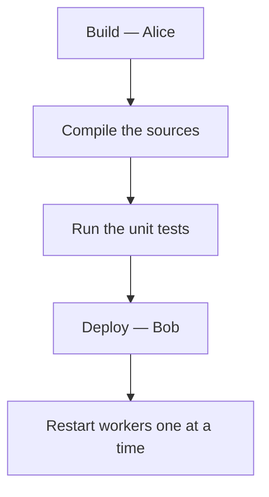

# P8h · The review's P8 as it was in run 2 (repaired reply)

* **Item:** `edit-diagram`
* **Run:** `run2-proposal` (HISTORICAL: the build that was reviewed; some evidence was not recorded then)
* **Code of that run:** `14e0cf12aa`
* **Request id:** `eb16ef4e-1053-43a4-863e-1efc27f40528`
* **Outcome:** published

## 1. The request

**Instruction, exactly as sent:**

> Draw a flowchart of the build and deploy steps.

* **Operation:** edit
* **Sources selected (names, immutable versions):**
  none selected
* **Open document:** none (no open document was read for this request)

## 2. What the request read (original material)

unavailable: this record has no ranked candidates (earlier run). The sources are in `../fixtures/`; the reader can open the cited passages below.

Fixture files for this item (synthetic):
* [`launch-plan.md`](../fixtures/launch-plan.md)
* [`release.md`](../fixtures/release.md)

## 3. The output, complete

### Change 1: `insert_blocks_after`

*The model's reason:* Show the documented build sequence followed by deployment and its worker restart step.
*Cites:* [1], [2], [3]

**Before:**

(nothing)

**After:**

## 4. Citations and what they open to

This output cites nothing (no evidence label was used).

## 5. Automated results (mechanical; none is a judgement of truth, completeness or usefulness)

| Check | What it is | Result |
|---|---|---|
| Published | the request produced a pending proposal | True |
| Valid on the first reply / repaired | the first reply passed the shared document engine / one repair was used (codes of the first problems) | False / True (diagram_html_not_allowed) |
| Target blocks and anchors resolve | the base hashes and anchors still match the captured document and a replay of the operations is valid | True |
| Citation validity | share of operations or blocks whose citations are valid (not a check of support) | 1.0 |
| Qualification review flags | the app's word-level review notes on rewrites (hedges, state of the work, negation, conditions, attribution, figures); a note, never a verdict | unavailable in this run |
| Latency (s) | end to end | 16.6 |

## 6. Agent assessment (my own reading, written by hand after the run; it is NOT a human review and it can be wrong)

* The repaired reply of run 2: plain Mermaid, a chain Build, its tasks, Deploy, with owners, matching the source's facts. The unsafe first reply (HTML in a diagram) never reached the preview. Like A6, it drew an order the source does not state and said nothing about it; the new build's P4 is the same request with the assumption disclosed.

## 7. Human review (leave blank until you assess it)

| Field | Your assessment |
|---|---|
| Factual support: is every statement supported by the original text shown above? (supported / partly / unsupported / not applicable) | |
| Completeness: does it cover what was asked? (complete / partial / missing key points) | |
| Usefulness: would you use it? (1 poor ... 5 very useful) | |
| Edit safety: would you apply it as is? (safe / needs changes / unsafe) and what would go wrong if applied | |
| Meaning preserved: does the new text keep every qualification of the old (planned vs done, may vs will, numbers, conditions, who said it)? | |
| Notes | |
