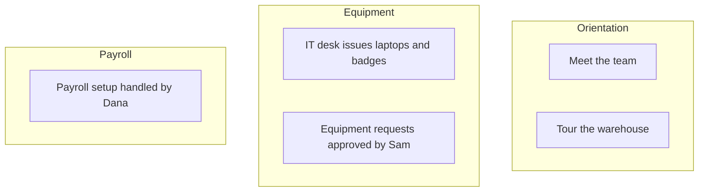

# Q5 · Diagram of steps whose order is not stated: answer (held-out)

* **Item:** `diagram-onboarding-answer`
* **Run:** `new-quality-heldout`
* **Code of that run:** `0e94ef38ed`
* **Request id:** `2ec3c926-5dd0-41dd-a135-25ac68170f13`
* **Outcome:** published

## 1. The request

**Instruction, exactly as sent:**

> Draw a diagram of the onboarding steps.

* **Operation:** answer in chat
* **Route:** the model chose `qa`, the request ran as `qa` (fallback used: no; hint `auto`)
* **Sources selected (names, immutable versions):**
  * `onboarding.md` version 1 (`84df8a7c-cd06-4644-a00d-78de729dcd57`), read as **retrieval**: 4 of 4 sections, 4 passages used
* **Open document:** none (no open document was read for this request)

## 2. What the request read (original material)

See the citations below: each lists the original text it opens to.

Fixture files for this item (synthetic):
* [`onboarding.md`](../fixtures/onboarding.md)

## 3. The output, complete

**Diagram: Onboarding items (no sequence specified)** (render status: ok; cites [1, 2, 3, 4])

## 4. Citations and what they open to

#### [1] `P1` · passage · `onboarding.md` · Onboarding
* **What the reader sees as the excerpt:** text of the cited passage
* **Extraction:** plain
* **Provenance recorded:** complete
Excerpt shown to the reader (the first 300 characters the system keeps):
> Onboarding
> New hires complete several onboarding items.
**Original text 1 of 1** · `onboarding.md` version 1 · Onboarding, part 1, extraction: plain · stored-text check: **verified**
> Onboarding
> New hires complete several onboarding items.

#### [2] `P2` · passage · `onboarding.md` · Onboarding > Orientation
* **What the reader sees as the excerpt:** text of the cited passage
* **Extraction:** plain
* **Provenance recorded:** complete
Excerpt shown to the reader (the first 300 characters the system keeps):
> Orientation
> - meet the team
> - tour the warehouse
**Original text 1 of 1** · `onboarding.md` version 1 · Onboarding > Orientation, part 2, extraction: plain · stored-text check: **verified**
> Orientation
> - meet the team
> - tour the warehouse

#### [3] `P3` · passage · `onboarding.md` · Onboarding > Equipment
* **What the reader sees as the excerpt:** text of the cited passage
* **Extraction:** plain
* **Provenance recorded:** complete
Excerpt shown to the reader (the first 300 characters the system keeps):
> Equipment
> The IT desk issues laptops and badges. Equipment requests are approved by Sam.
**Original text 1 of 1** · `onboarding.md` version 1 · Onboarding > Equipment, part 4, extraction: plain · stored-text check: **verified**
> Equipment
> The IT desk issues laptops and badges. Equipment requests are approved by Sam.

#### [4] `P4` · passage · `onboarding.md` · Onboarding > Payroll
* **What the reader sees as the excerpt:** text of the cited passage
* **Extraction:** plain
* **Provenance recorded:** complete
Excerpt shown to the reader (the first 300 characters the system keeps):
> Payroll
> Payroll setup is handled by Dana.
**Original text 1 of 1** · `onboarding.md` version 1 · Onboarding > Payroll, part 3, extraction: plain · stored-text check: **verified**
> Payroll
> Payroll setup is handled by Dana.

## 5. Automated results (mechanical; none is a judgement of truth, completeness or usefulness)

| Check | What it is | Result |
|---|---|---|
| Finding | the finding this item tests (tests/eval/quality.py) | F4 |
| Finding met | this item against its finding's criterion, from the structural and semantic results below (NOT a human judgement) | True |
| Why | the checks behind the verdict | diagram checks [{'draws_order': False, 'order_disclosed': True, 'possibly_invented_labels': []}] |
| Structural | valid, rendered, cited: says the output is VALID | {"published": true, "diagram_renders": true, "first_try_valid": null, "repaired": null, "provenance_incomplete": 0, "invalid_citations": 0} |
| Semantic | deterministic content checks against a written rubric: concepts present, figures not in the material, placeholder, order disclosed, labels possibly invented | {"unsupported_figures": [], "placeholder_hits": [], "diagrams": [{"draws_order": false, "order_disclosed": true, "possibly_invented_labels": []}]} |

## 6. Agent assessment (my own reading, written by hand after the run; it is NOT a human review and it can be wrong)

* Look at fixtures/onboarding.md: three items (Orientation, Payroll, Equipment) and no order. The diagram groups them in three boxes with no arrows, and its title says 'no sequence specified', which also appears in the chat text. Every box text is in the source (Dana, Sam and the IT desk are the source's own words). Nothing is invented.
* This is the behaviour the contract asks for when order is not stated: group, do not chain. I did not check how the diagram looks when rendered; the automated check says only that the Mermaid parses.

## 7. Human review (leave blank until you assess it)

| Field | Your assessment |
|---|---|
| Factual support: is every statement supported by the original text shown above? (supported / partly / unsupported / not applicable) | |
| Completeness: does it cover what was asked? (complete / partial / missing key points) | |
| Usefulness: would you use it? (1 poor ... 5 very useful) | |
| Notes | |
