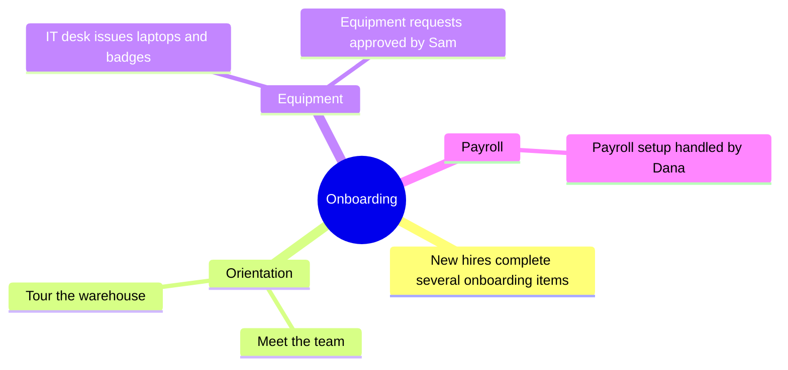

# Q6 · Diagram of steps whose order is not stated: proposal (held-out)

* **Item:** `diagram-onboarding-edit`
* **Run:** `new-quality-heldout`
* **Code of that run:** `0e94ef38ed`
* **Request id:** `5d7644e6-7b21-487d-b892-62cd60628c61`
* **Outcome:** published

## 1. The request

**Instruction, exactly as sent:**

> Draw a diagram of the onboarding steps.

* **Operation:** edit
* **Sources selected (names, immutable versions):**
  none selected
* **Open document:** document `b6bd786c-720a-4b69-94c7-d16a76bab798`, captured at update counter 7, scope `edit`, mode `target_plus_context`; context shown to the model: **full** (complete), 5 of 5 blocks, 0 not shown, 0 cut short

## 2. What the request read (original material)

See the citations below: each lists the original text it opens to.

Fixture files for this item (synthetic):
* [`onboarding.md`](../fixtures/onboarding.md)
* [`rollout.md`](../fixtures/rollout.md)

## 3. The output, complete

**Summary the model gave:** Propose an onboarding diagram that groups the documented items without implying a sequence, since no order is specified.

### Change 1: `insert_blocks_after`

*The model's reason:* Group the documented onboarding items and responsibilities by topic; the source does not specify a chronological order.
*Cites:* [1], [2], [3], [4]

**Before:**

(nothing)

**After:**

## 4. Citations and what they open to

#### [1] `P1` · passage · `onboarding.md` · Onboarding
* **What the reader sees as the excerpt:** text of the cited passage
* **Extraction:** plain
* **Provenance recorded:** complete
* **Validated quotations:** “New hires complete several onboarding items.”
Excerpt shown to the reader (the first 300 characters the system keeps):
> Onboarding
> New hires complete several onboarding items.
**Original text 1 of 1** · `onboarding.md` version 1 · Onboarding, part 1, extraction: plain · stored-text check: **verified**
> Onboarding
> New hires complete several onboarding items.

#### [2] `P2` · passage · `onboarding.md` · Onboarding > Orientation
* **What the reader sees as the excerpt:** text of the cited passage
* **Extraction:** plain
* **Provenance recorded:** complete
* **Validated quotations:** “- meet the team - tour the warehouse”
Excerpt shown to the reader (the first 300 characters the system keeps):
> Orientation
> - meet the team
> - tour the warehouse
**Original text 1 of 1** · `onboarding.md` version 1 · Onboarding > Orientation, part 2, extraction: plain · stored-text check: **verified**
> Orientation
> - meet the team
> - tour the warehouse

#### [3] `P3` · passage · `onboarding.md` · Onboarding > Equipment
* **What the reader sees as the excerpt:** text of the cited passage
* **Extraction:** plain
* **Provenance recorded:** complete
* **Validated quotations:** “The IT desk issues laptops and badges. Equipment requests are approved by Sam.”
Excerpt shown to the reader (the first 300 characters the system keeps):
> Equipment
> The IT desk issues laptops and badges. Equipment requests are approved by Sam.
**Original text 1 of 1** · `onboarding.md` version 1 · Onboarding > Equipment, part 4, extraction: plain · stored-text check: **verified**
> Equipment
> The IT desk issues laptops and badges. Equipment requests are approved by Sam.

#### [4] `P4` · passage · `onboarding.md` · Onboarding > Payroll
* **What the reader sees as the excerpt:** text of the cited passage
* **Extraction:** plain
* **Provenance recorded:** complete
* **Validated quotations:** “Payroll setup is handled by Dana.”
Excerpt shown to the reader (the first 300 characters the system keeps):
> Payroll
> Payroll setup is handled by Dana.
**Original text 1 of 1** · `onboarding.md` version 1 · Onboarding > Payroll, part 3, extraction: plain · stored-text check: **verified**
> Payroll
> Payroll setup is handled by Dana.

## 5. Automated results (mechanical; none is a judgement of truth, completeness or usefulness)

| Check | What it is | Result |
|---|---|---|
| Finding | the finding this item tests (tests/eval/quality.py) | F4 |
| Finding met | this item against its finding's criterion, from the structural and semantic results below (NOT a human judgement) | True |
| Why | the checks behind the verdict | diagram checks [{'draws_order': False, 'order_disclosed': True, 'possibly_invented_labels': []}] |
| Structural | valid, rendered, cited: says the output is VALID | {"published": true, "diagram_renders": true, "first_try_valid": true, "repaired": false, "provenance_incomplete": 0, "invalid_citations": 0} |
| Semantic | deterministic content checks against a written rubric: concepts present, figures not in the material, placeholder, order disclosed, labels possibly invented | {"unsupported_figures": [], "placeholder_hits": [], "diagrams": [{"draws_order": false, "order_disclosed": true, "possibly_invented_labels": []}]} |

## 6. Agent assessment (my own reading, written by hand after the run; it is NOT a human review and it can be wrong)

* The same source as an edit proposal: a Mermaid mindmap with 'Onboarding' at the centre and the three items as branches, no ordering, and the model's own summary says it groups the items 'without implying a sequence, since no order is specified'. Its four citations point at the source sections.
* A mindmap is a different diagram type from the flowchart of Q5; both are allowed by the contract. Nothing needed an assumption note, so none was added, and none is shown in the preview.

## 7. Human review (leave blank until you assess it)

| Field | Your assessment |
|---|---|
| Factual support: is every statement supported by the original text shown above? (supported / partly / unsupported / not applicable) | |
| Completeness: does it cover what was asked? (complete / partial / missing key points) | |
| Usefulness: would you use it? (1 poor ... 5 very useful) | |
| Edit safety: would you apply it as is? (safe / needs changes / unsafe) and what would go wrong if applied | |
| Meaning preserved: does the new text keep every qualification of the old (planned vs done, may vs will, numbers, conditions, who said it)? | |
| Notes | |
